# Spool Film Processor

**English** · [Polski](README.pl.md)

A DIY film developing processor (C-41, B&W, E-6, ECN-2, RA-4). A stepper motor agitates the reels inside the tank, and everything is controlled from a small 2.4" touch screen (about 49×38 mm). The firmware times every step and corrects the time live for chemistry temperature and chemistry reuse.

**Firmware version: v2.1**

<p align="center">
  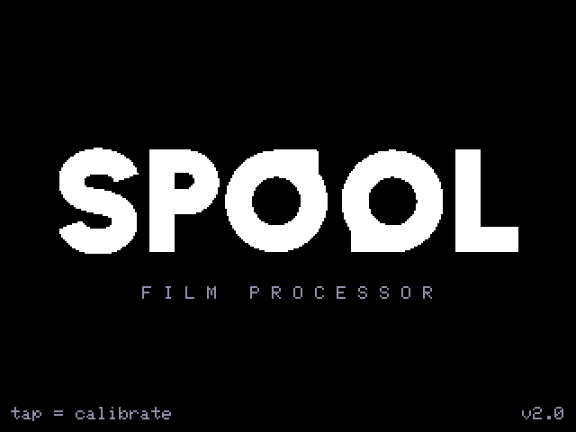
  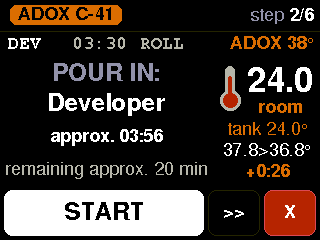
</p>

> 🖨️ **3D print files** (enclosure – PETG front, PLA-CF back – tank seat and agitator) will be published on **[MakerWorld](https://makerworld.com/)** later. The link will be added here.

---

## Contents
- [How it works](#how-it-works)
- [Photos](#photos)
- [Screens](#screens)
- [Temperature and chemistry-reuse compensation](#temperature-and-chemistry-reuse-compensation)
- [“Probe not in chemistry” mode](#probe-not-in-chemistry-mode)
- [Programs and settings](#programs-and-settings)
- [Hardware](#hardware)
  - [Build diagrams](#build-diagrams)
- [Flashing the firmware](#flashing-the-firmware)
- [Repository layout](#repository-layout)

---

## How it works

1. The **tank** (e.g. Paterson Multi Reel 3: 3×35 mm or 2×120) sits in the device's seat. The motor turns the reels through the agitator.
2. You **pick a program**, e.g. “ADOX C-TEC 41”. A program is a list of steps (pre-heat, developer, rinse, blix, rinse, stabilizer). Each step has a time, an agitation mode and a temperature-control mode.
3. Before the run, the device asks about the **setup**: is the processor upright or lying, does the probe touch the chemistry, how much chemistry, and what is the pre-wash water temperature.
4. For each step the screen tells you **what to pour**. Press **START** (on the screen or the BOOT button): the motor starts agitating and the timer counts down.
5. **The time is corrected live.** If the chemistry is cooler than nominal, or already used, the step gets longer. The screen shows by how much (“+1:08”) and the total multiplier (e.g. “x1.35”).
6. When a step ends, a melody plays and the screen shows **“DRAIN”**. The motor stops and a 15 s drain countdown runs before the next step.
7. At the end you get **“DONE!”**. Enter how many rolls were in the tank and the device remembers the chemistry usage. Next time it automatically lengthens the developer and blix times.

After power-on the device opens the **last used program** right away. Back goes to the program list and to the process types.

---

## Photos

<table>
<tr>
<td width="50%" valign="top" align="center">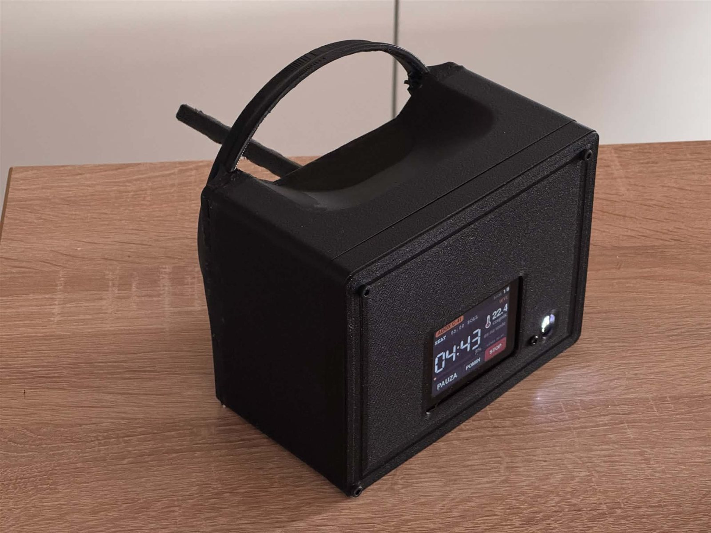</td>
<td width="50%" valign="top" align="center">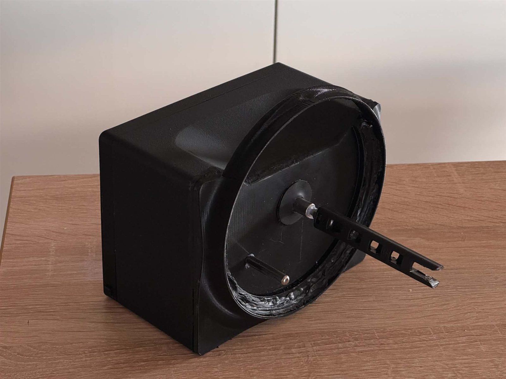</td>
</tr>
<tr>
<td width="50%" valign="top">Finished device: PETG front with the touch screen and battery indicator, handle on top.</td>
<td width="50%" valign="top">Tank seat with the O-ring groove, agitator shaft and positioning pin.</td>
</tr>
<tr>
<td width="50%" valign="top" align="center">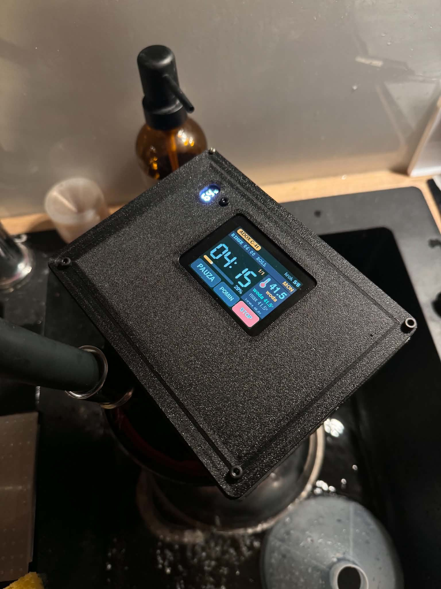</td>
<td width="50%" valign="top" align="center">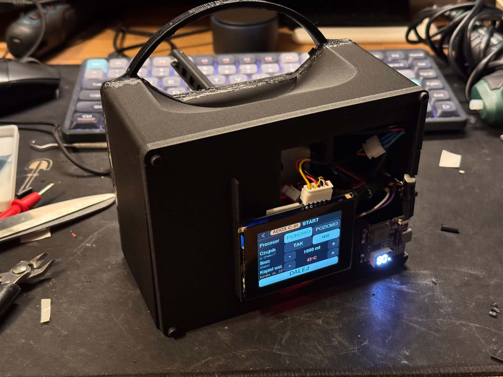</td>
</tr>
<tr>
<td width="50%" valign="top">In use at the sink: rinse step, the probe reads the tap water (41.5 °C).</td>
<td width="50%" valign="top">Assembly: display and ESP32-C3 board fitted, START setup screen.</td>
</tr>
<tr>
<td width="50%" valign="top" align="center">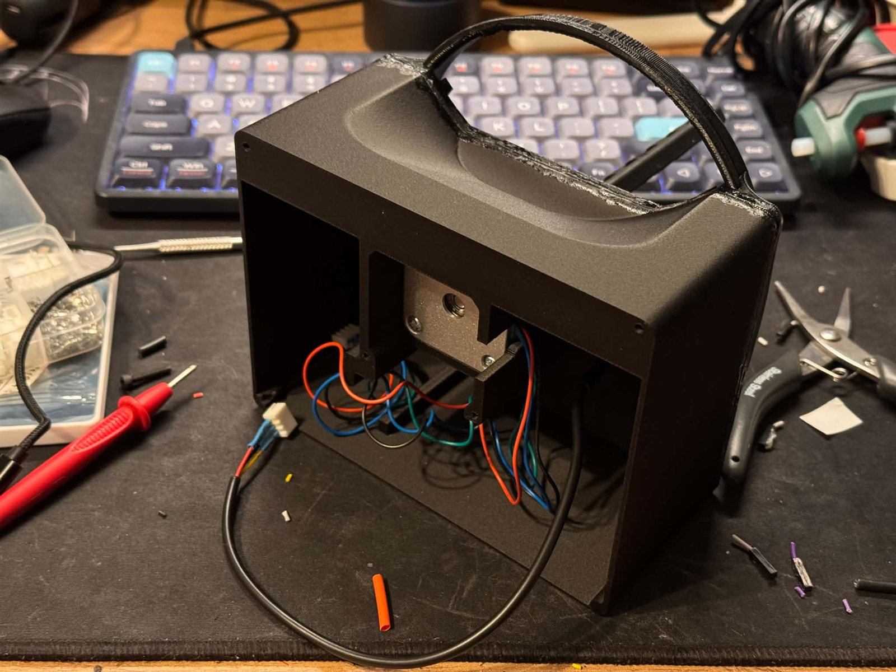</td>
<td width="50%" valign="top" align="center">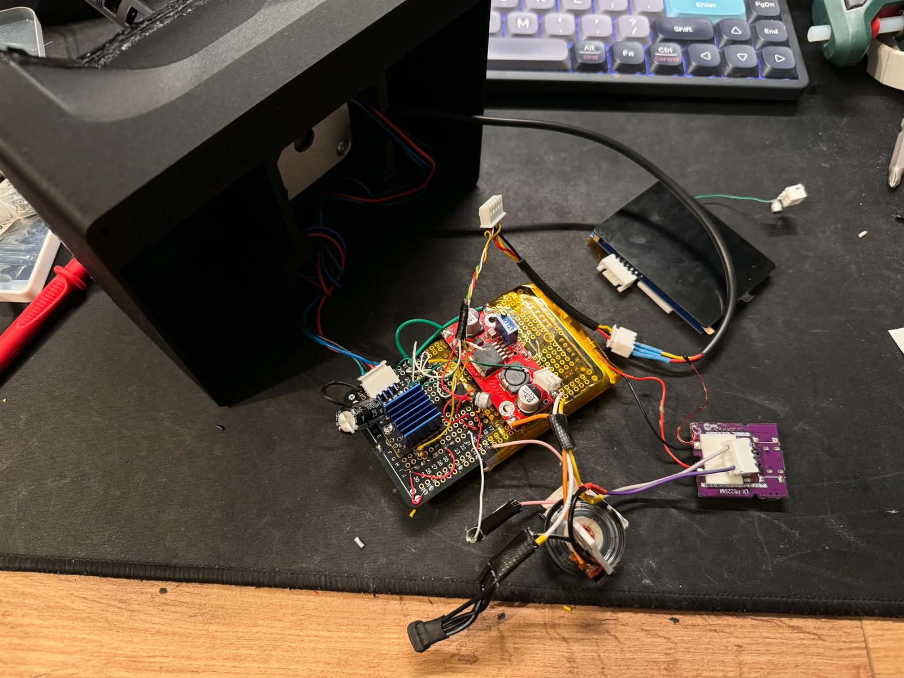</td>
</tr>
<tr>
<td width="50%" valign="top">Enclosure with the NEMA17 motor mount.</td>
<td width="50%" valign="top">Electronics: TMC2209 with heatsink, XL6009, charger module, LM386 on perfboard, battery.</td>
</tr>
</table>

<p align="center">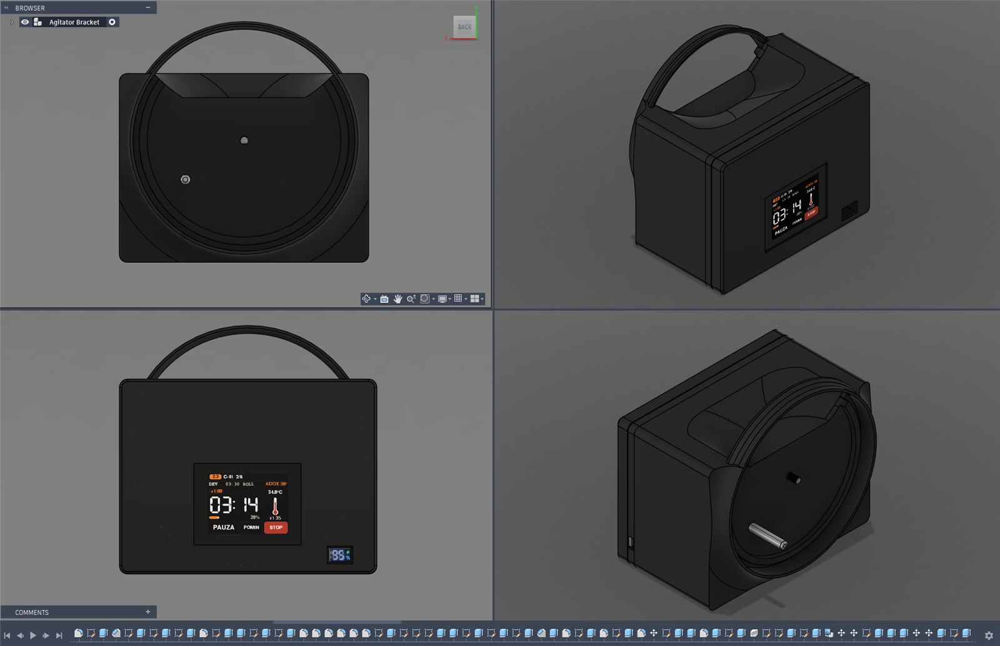<br><i>Fusion 360 model – 3D print files coming soon on MakerWorld.</i></p>

---

## Screens

All screenshots are taken directly from the device (320×240 screen, scaled 2× here). The UI is available in English and Polish.

### Choosing a program

<table>
<tr>
<td width="50%" valign="top" align="center">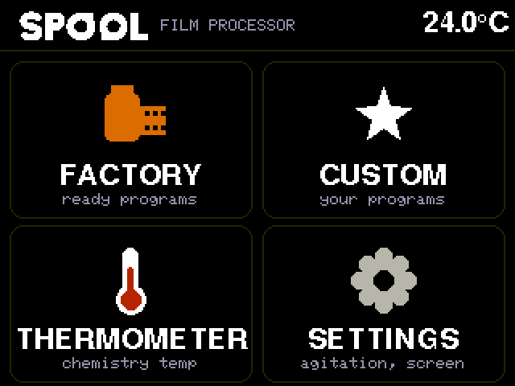</td>
<td width="50%" valign="top" align="center">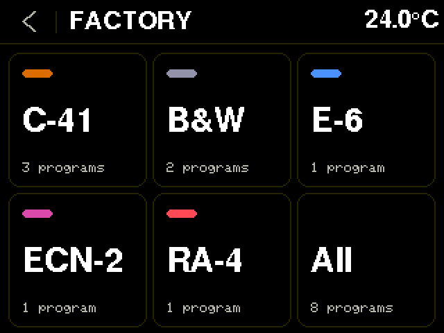</td>
</tr>
<tr>
<td width="50%" valign="top"><b>Main menu:</b> factory programs, custom programs, thermometer, settings.</td>
<td width="50%" valign="top"><b>Process type:</b> C-41, B&W, E-6, ECN-2 and RA-4 tiles with the number of programs.</td>
</tr>
<tr>
<td width="50%" valign="top" align="center">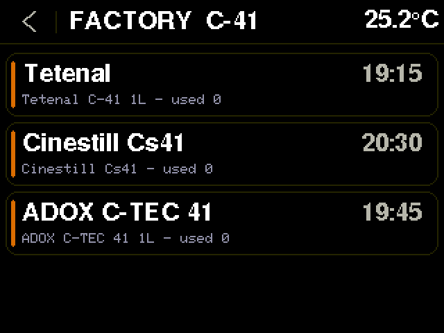</td>
<td width="50%" valign="top" align="center">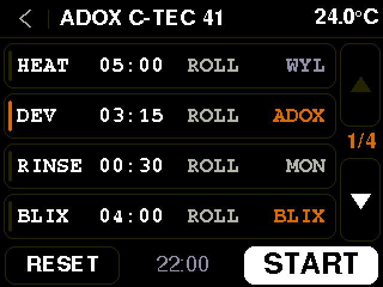</td>
</tr>
<tr>
<td width="50%" valign="top"><b>Program list</b> with total time, chemistry kit and rolls used.</td>
<td width="50%" valign="top"><b>Program:</b> steps with time, agitation (ROLL) and temperature control (ADOX curve; MON = monitor only).</td>
</tr>
<tr>
<td width="50%" valign="top" align="center">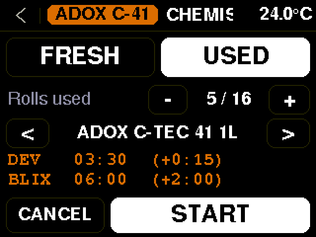</td>
<td width="50%" valign="top" align="center">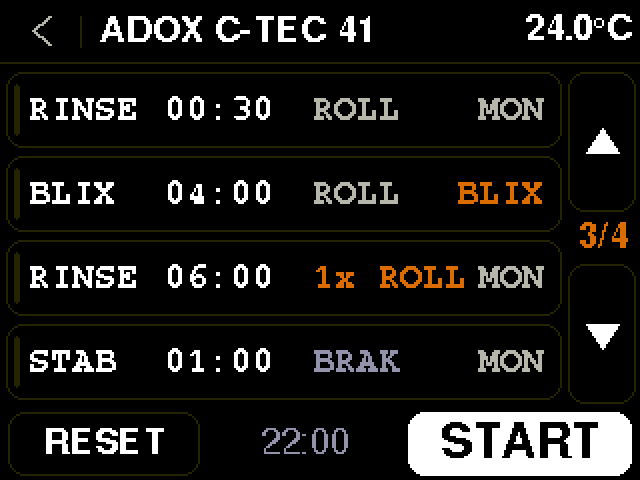</td>
</tr>
<tr>
<td width="50%" valign="top"><b>Chemistry:</b> fresh or used, rolls used, kit (ADOX, Tetenal, Bellini, Cinestill…). Below: how much longer the developer and blix will take.</td>
<td width="50%" valign="top"><b>Rinse by water changes</b>, e.g. “6x ROLL”: 6 water changes within the step time.</td>
</tr>
</table>

### Setup and start

<table>
<tr>
<td width="50%" valign="top" align="center">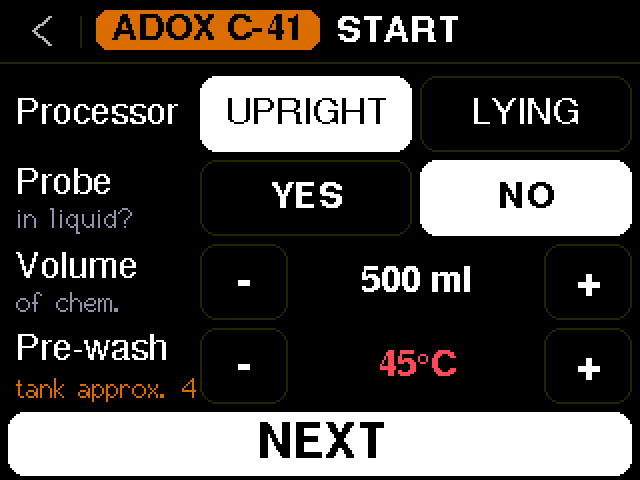</td>
<td width="50%" valign="top" align="center">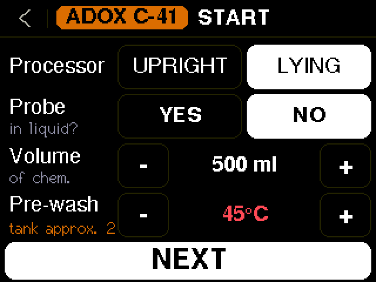</td>
</tr>
<tr>
<td width="50%" valign="top"><b>START screen:</b> upright or lying, does the probe touch the chemistry, chemistry volume, pre-wash temperature. Below: predicted tank temperature when the chemistry is poured.</td>
<td width="50%" valign="top">Settings are <b>remembered per program</b>, so usually you just press NEXT.</td>
</tr>
<tr>
<td width="50%" valign="top" align="center">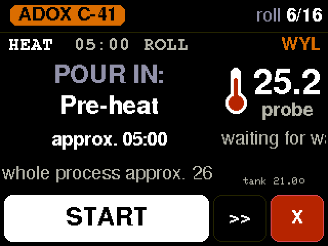</td>
<td width="50%" valign="top" align="center">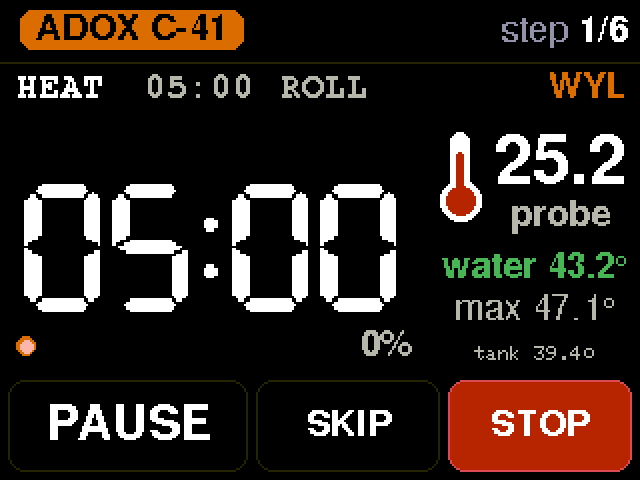</td>
</tr>
<tr>
<td width="50%" valign="top"><b>First step:</b> “roll 6/16” at the top (chemistry usage check), estimated time of the whole process at the bottom.</td>
<td width="50%" valign="top"><b>Pre-wash:</b> the probe measures tap water (last peak, maximum). Green = 38–45 °C.</td>
</tr>
</table>

### During the process

<table>
<tr>
<td width="50%" valign="top" align="center"></td>
<td width="50%" valign="top" align="center">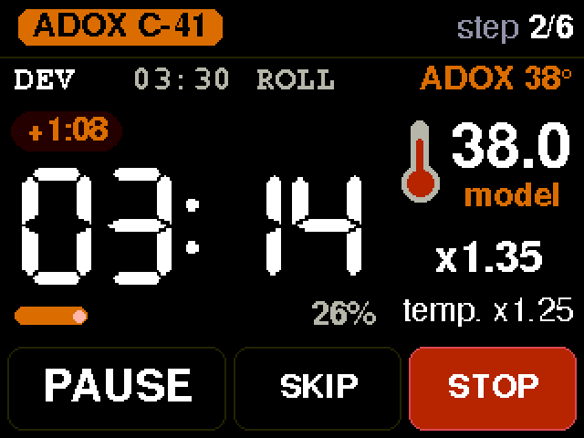</td>
</tr>
<tr>
<td width="50%" valign="top"><b>POUR IN: Developer</b> – estimated step time, remaining time of the whole process, temperature.</td>
<td width="50%" valign="top"><b>Countdown:</b> big timer, progress bar, extension (“+1:08”) and the total time multiplier; the bottom line alternates between temperature and chemistry factors every 3 s.</td>
</tr>
<tr>
<td width="50%" valign="top" align="center">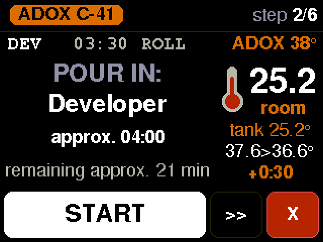</td>
<td width="50%" valign="top" align="center">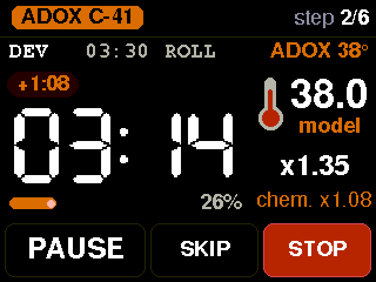</td>
</tr>
<tr>
<td width="50%" valign="top"><b>Probe not in chemistry:</b> room temperature, modelled tank temperature and a forecast for the step (“37.8>36.9°”, “+0:24”).</td>
<td width="50%" valign="top">During the step the big number is the <b>chemistry temperature from the thermal model</b>.</td>
</tr>
<tr>
<td width="50%" valign="top" align="center">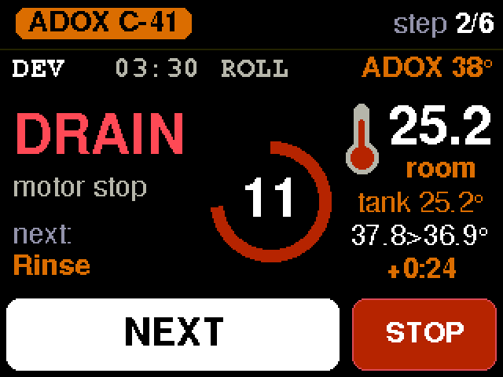</td>
<td width="50%" valign="top" align="center">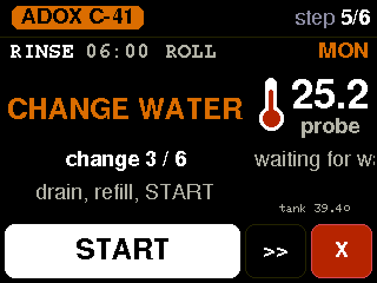</td>
</tr>
<tr>
<td width="50%" valign="top"><b>DRAIN:</b> motor stopped, 15 s drain countdown, next step shown.</td>
<td width="50%" valign="top"><b>Water change</b> during a rinse by water changes (3 of 6).</td>
</tr>
<tr>
<td width="50%" valign="top" align="center">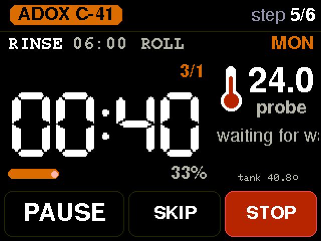</td>
<td width="50%" valign="top" align="center">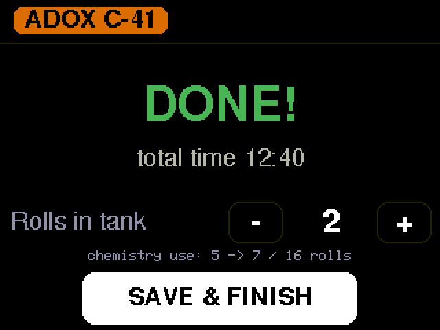</td>
</tr>
<tr>
<td width="50%" valign="top">Countdown of one water change.</td>
<td width="50%" valign="top"><b>DONE:</b> total time and rolls in the tank; chemistry usage is stored on SAVE & FINISH.</td>
</tr>
</table>

### Settings and tools

<table>
<tr>
<td width="50%" valign="top" align="center">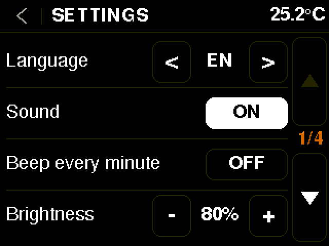</td>
<td width="50%" valign="top" align="center">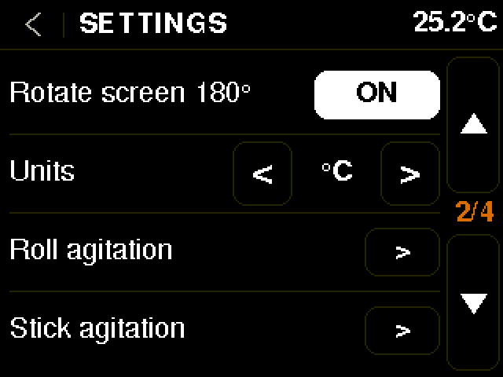</td>
</tr>
<tr>
<td width="50%" valign="top">Language EN / PL, sound, minute beeps, brightness.</td>
<td width="50%" valign="top">Rotate screen 180°, units °C / °F, agitation parameters.</td>
</tr>
<tr>
<td width="50%" valign="top" align="center">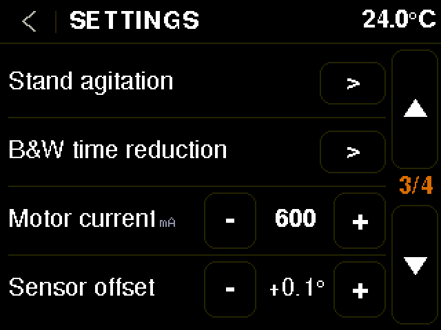</td>
<td width="50%" valign="top" align="center">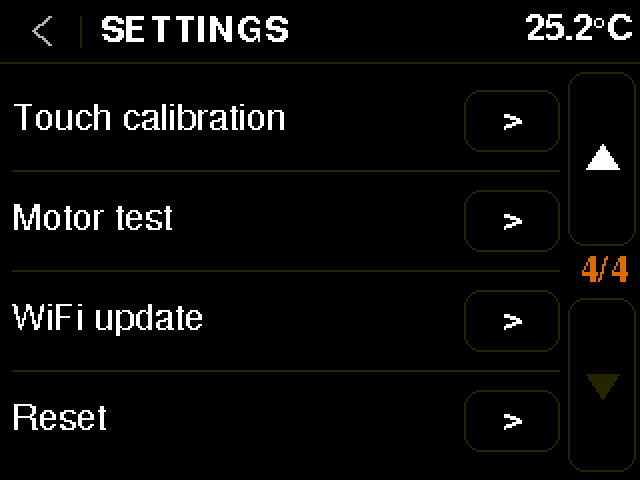</td>
</tr>
<tr>
<td width="50%" valign="top">Motor current, probe offset, B&W time reduction.</td>
<td width="50%" valign="top">Touch calibration, motor test, WiFi update, reset.</td>
</tr>
<tr>
<td width="50%" valign="top" align="center">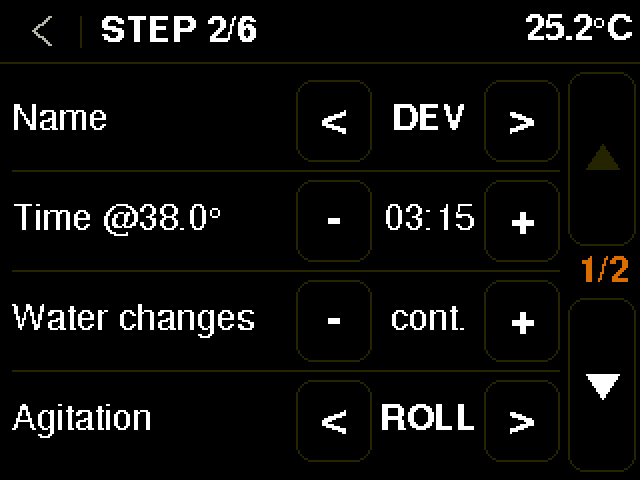</td>
<td width="50%" valign="top" align="center">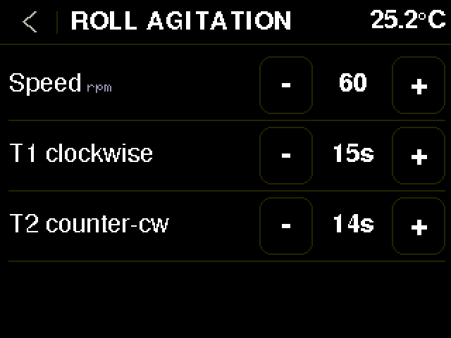</td>
</tr>
<tr>
<td width="50%" valign="top"><b>Step editor:</b> name, time, water changes, agitation, temperature control.</td>
<td width="50%" valign="top"><b>ROLL agitation:</b> speed and clockwise / counter-clockwise times.</td>
</tr>
<tr>
<td width="50%" valign="top" align="center">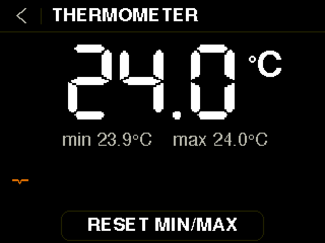</td>
<td width="50%" valign="top" align="center">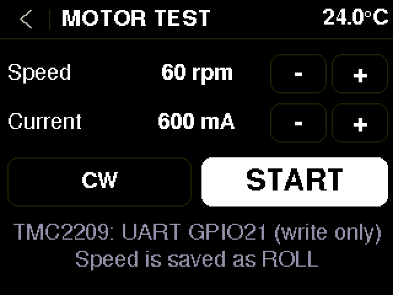</td>
</tr>
<tr>
<td width="50%" valign="top"><b>Thermometer</b> with min / max.</td>
<td width="50%" valign="top"><b>Motor test</b> – speed, current, direction.</td>
</tr>
<tr>
<td width="50%" valign="top" align="center"></td>
<td width="50%" valign="top" align="center">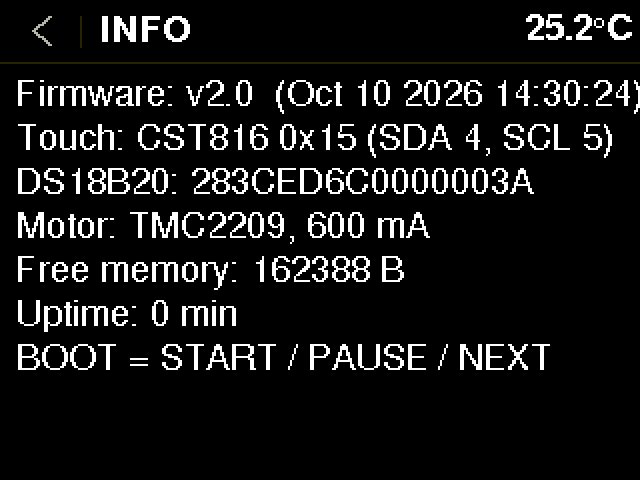</td>
</tr>
<tr>
<td width="50%" valign="top"><b>Touch calibration:</b> 3 crosses; started by touching the screen while the logo is shown.</td>
<td width="50%" valign="top"><b>Info:</b> firmware version with build date, sensors, memory.</td>
</tr>
</table>

*The boot and Info screenshots were taken on v2.0; v2.1 only differs in the version number.*

---

## Temperature and chemistry-reuse compensation

**Temperature.** Each chemistry type has a time-vs-temperature curve (e.g. ADOX C-TEC 41: 38 °C = 1.0×, 30 °C ≈ 2.46×). The firmware continuously computes the factor for the current temperature and integrates the step progress:

```
progress += dt / (base_time × F(T) × reuse)
```

So if the chemistry cools down during the step, the step gets longer by exactly the right amount, instead of a one-off correction at the start.

**Chemistry reuse.** For kits with a manufacturer table (ADOX, Tetenal: groups of 4 rolls per 1 L) the developer and blix times grow with every roll. Values between the 38 °C and 30 °C tables are interpolated by temperature. Bellini: +15 s every 3 rolls. Cinestill and the generic kit: +2% per roll. There is no hard limit: choosing “fresh” on the chemistry screen resets the counter, and a “!” appears once the manufacturer's capacity is exceeded.

## “Probe not in chemistry” mode

With little chemistry (e.g. an upright Paterson with 3 reels) the probe does not reach the liquid and measures air. Then:

- the **room temperature** is stored once, at the start;
- during **pre-wash and rinses** the probe works as a **tap-water thermometer**: it detects water contact, keeps the last peak and maximum, shows “steady” once the tank is full, and **beeps** when the water is too hot (> 45 °C) or too cold (< 38 °C);
- the **chemistry temperature is computed by a thermal model of the tank**: liquid ↔ walls and reels ↔ room. It includes natural convection (Churchill–Chu correlations for a vertical wall and a horizontal cylinder), radiation, conduction through the polystyrene wall and the water left in the tank. The model runs in real time, including while the empty tank waits for the chemistry;
- example (500 ml, upright, room 21 °C, ADOX 3:15): tank after a 45 °C pre-wash → chemistry 38.0 → 37.7 °C, correction 0…+3 s. Cold tank → +33 s.

## Programs and settings

- 8 factory programs (C-41 Tetenal / Cinestill / ADOX, B&W, E-6, ECN-2, RA-4) and 4 custom ones (copied from factory programs).
- Agitation **ROLL** (alternating directions), **STICK**, **STAND** (stand development) or none.
- Step time control: temperature curve, **MON** (range monitor only) or off.
- Everything is stored on the board: settings, calibration, programs, chemistry usage and the last choice.
- Serial commands (115200 baud): `i` info, `t` temperature, `r`/`s` motor, `a`/`f`/`h`/`c` sounds, `K` thermal model table, `P` screenshots, `L` toggle language.

---

## Hardware

| Part | Model |
|---|---|
| Controller + display | ESP32-C3 with 2.4" ST7789 TFT and CST816 touch (msalamon EVB-00055) |
| Motor | JK42HS48-1204 (NEMA17) + TMC2209 (Tenstar V985) over single-wire UART |
| Temperature | DS18B20, waterproof |
| Power | Li-ion 3.7 V 5000 mAh, USB-C charger/boost 5 V 4 A, XL6009 → 12 V |
| Sound | LM386 + 14 Ω speaker |
| Seals | O-ring 131×3 NBR70 (tank seat), shaft seal 8×16×5 TC on an 8×1.5 stainless sleeve |

The board exposes only two free pins: GPIO21 drives the motor (UART) and GPIO20 reads the probe (1-Wire). The BOOT button (GPIO9) is START / PAUSE / NEXT and also feeds the speaker amplifier.

### Build diagrams

From the [documentation PDF](SpoolFilmProcessor_documentation_v2.1.pdf).

**Main wiring** – ESP32-C3, TMC2209, DS18B20, XL6009, charger module, battery:

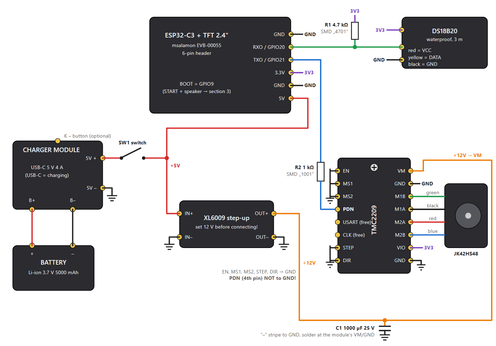

**Speaker** – LM386 amplifier driven from the BOOT pin (GPIO9):

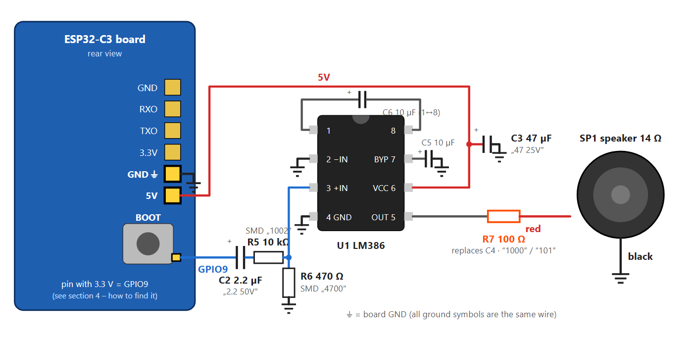

<table>
<tr>
<td width="50%" valign="top" align="center">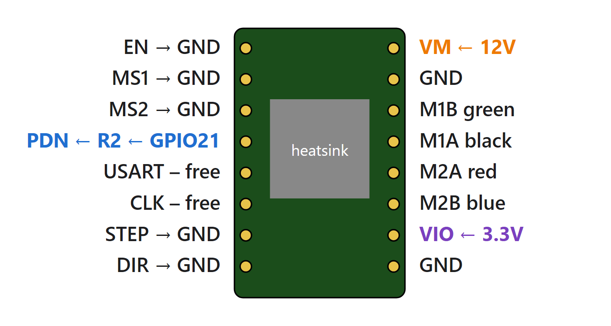</td>
<td width="50%" valign="top" align="center">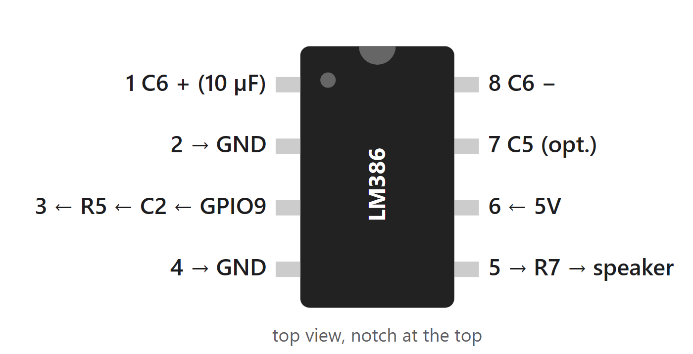</td>
</tr>
<tr>
<td width="50%" valign="top"><b>TMC2209 V985</b> pinout – PDN via 1 kΩ to GPIO21, VIO to 3.3 V.</td>
<td width="50%" valign="top"><b>LM386</b> pinout (top view).</td>
</tr>
<tr>
<td width="50%" valign="top" align="center">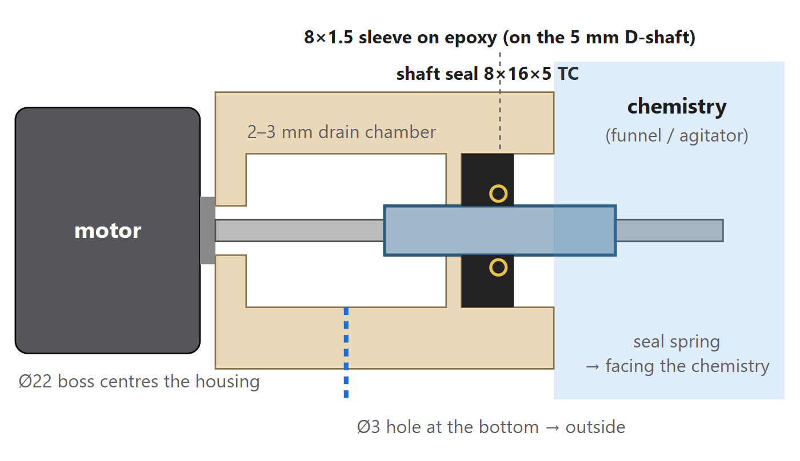</td>
<td width="50%" valign="top" align="center">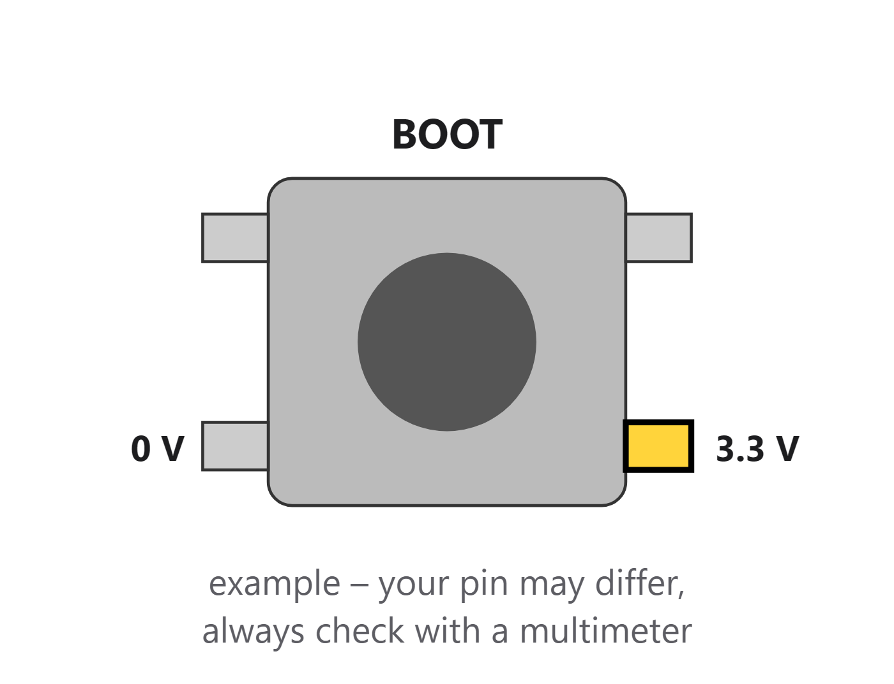</td>
</tr>
<tr>
<td width="50%" valign="top"><b>Shaft seal</b> – 8×1.5 sleeve on the D-shaft, 8×16×5 seal, drain chamber.</td>
<td width="50%" valign="top"><b>BOOT button</b> – find the GPIO9 pin (3.3 V) with a multimeter.</td>
</tr>
<tr>
<td width="50%" valign="top" align="center">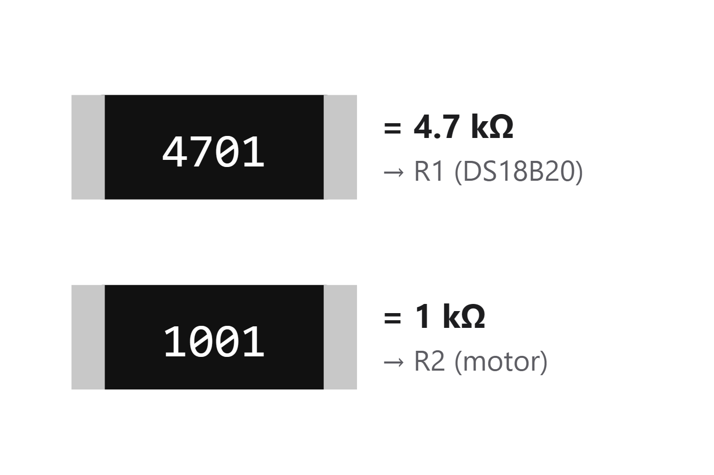</td>
<td width="50%" valign="top" align="center">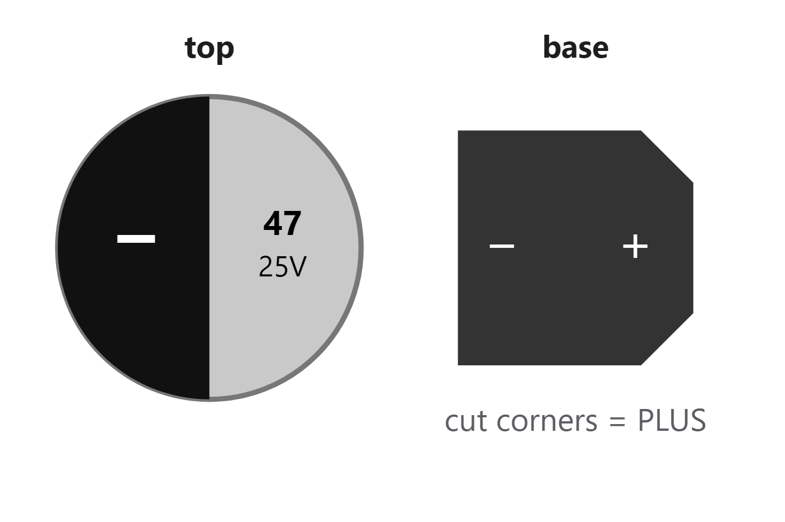</td>
</tr>
<tr>
<td width="50%" valign="top"><b>SMD resistor</b> codes (4701 = 4.7 kΩ, 1001 = 1 kΩ).</td>
<td width="50%" valign="top"><b>SMD electrolytic</b> polarity (black field = minus).</td>
</tr>
</table>

Full bill of materials, schematics, wiring tables, assembly and sealing details: **[SpoolFilmProcessor_documentation_v2.1.pdf](SpoolFilmProcessor_documentation_v2.1.pdf)** (source: [documentation.html](documentation.html); Polish version in [docs/pl](docs/pl)).

---

## Flashing the firmware

| Method | File | Settings on the board |
|---|---|---|
| Arduino IDE | folder [SpoolFilmProcessor](SpoolFilmProcessor) or [SpoolFilmProcessor_v2.1_ArduinoIDE.zip](firmware/SpoolFilmProcessor_v2.1_ArduinoIDE.zip) | kept |
| WiFi (Settings → WiFi update, network `FilmProcessor`, http://192.168.4.1) | [firmware/SpoolFilmProcessor_v2.1_update.bin](firmware/SpoolFilmProcessor_v2.1_update.bin) | kept |
| USB, update | `firmware/flash_update.bat` | kept |
| USB, new board (address 0x0) | `firmware/flash_full.bat` / [SpoolFilmProcessor_v2.1_full.bin](firmware/SpoolFilmProcessor_v2.1_full.bin) | erased |

The `.bat` scripts need `esptool.exe` in the `firmware` folder – download `esptool-windows-amd64.zip` from [espressif/esptool releases](https://github.com/espressif/esptool/releases). A new board can also be flashed without the scripts: [esptool-js](https://espressif.github.io/esptool-js/) in Chrome or Edge, address `0x0`.

**Arduino IDE:** `esp32` board package (Espressif) 3.x, libraries LovyanGFX, OneWire and DallasTemperature. Tools menu: *ESP32C3 Dev Module*, *USB CDC On Boot: Enabled*, *Partition Scheme: Minimal SPIFFS (1.9MB APP with OTA)*. Step-by-step setup: [INSTRUCTIONS.md](INSTRUCTIONS.md).

The default WiFi update password is `film1234` – change it in [config.h](SpoolFilmProcessor/config.h) (`OTA_PASS`).

## Repository layout

```
SpoolFilmProcessor/   source code (Arduino)
firmware/           ready-made .bin files, flashing scripts, Arduino IDE ZIP
docs/screens/       screenshots from the device
documentation.html  documentation (BOM, schematics, assembly, seals, usage)
SpoolFilmProcessor_documentation_v2.1.pdf
INSTRUCTIONS.md     environment setup, flashing and testing, step by step
docs/photos/        photos of the build and the Fusion 360 model
docs/schematics/    build diagrams (wiring, speaker, pinouts, shaft seal)
docs/pl/            Polish documentation, instructions and PDF
README.pl.md        this README in Polish
```

3D print files: coming soon on MakerWorld.
